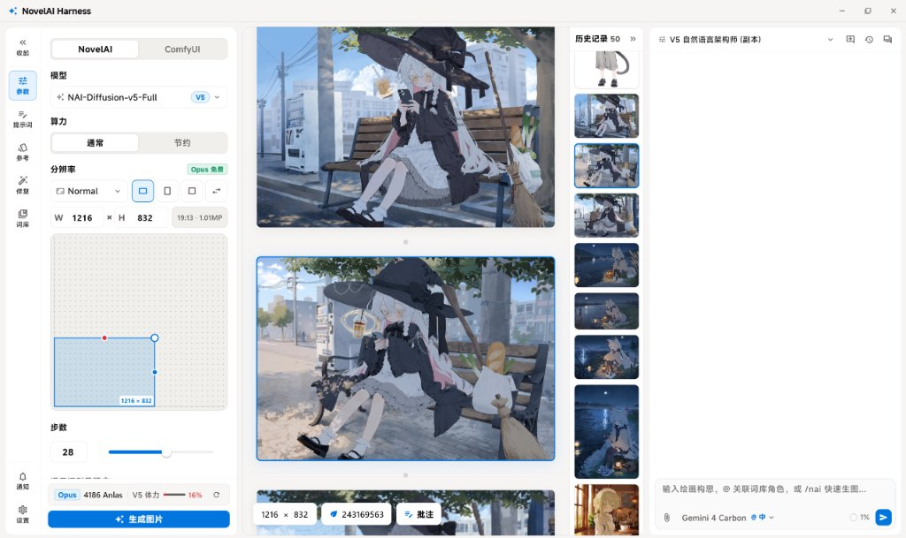

# NovelAI Harness

基于 Flutter 的 NovelAI 第三方跨平台客户端与 AI 对话工作台，支持 Windows、macOS、Linux 和 Android。

[](#安装与运行)
[](https://flutter.dev)
[](LICENSE)

## 界面预览


*完整工作台：参数设置、画板与历史记录、AI 对话*


*收起侧栏后的专注看图与对话模式*

## 主要功能

### 图像生成与参数
- **NovelAI 协议适配**：支持 NovelAI Diffusion V5 / V4.5 / V4 / V3 及 Furry 系列模型，提供 2D 分辨率面板、采样器与调度器配置、单并发排队和 429 重试。
- **额度与计费提示**：内置 Anlas 消耗计算、Opus 免费档提示以及 V5 体力状态显示。
- **参考与重绘**：支持精准参考（Character / Style / Outfit）、Vibe Transfer、多角色提示词与位置定位、局部重绘与焦点重绘。
- **ComfyUI 模式**：可通过 PromptToolkit AI Bridge 切换并连接本地 ComfyUI 进行参数下发与生图。

### AI 对话与工具调用
- **多协议 LLM 接入**：支持 OpenAI 兼容、Anthropic Messages 和 Google Gemini Interactions 接口，支持流式输出、思考强度切换、多模态图片发送与上下文压缩。
- **工作台工具协同**：AI 可在对话中直接调用工作台能力，包括修改生图参数、发起生图或局部重绘、查看画板图片、检索标签与管理词库，并支持按预设配置工具权限。
- **技能包支持**：支持导入和管理符合 `SKILL.md` 格式的技能包，按需加载说明与配套资源。

### 提示词与词库
- **标签补全与语法编辑**：内置 Danbooru 离线标签库与 NovelAI 官方专属标签，支持语法高亮、权重快捷调整、SD/NAI 语法互转以及 T5/Qwen Token 计数。
- **词组合预设库**：支持按分类保存可复用提示词组合与预览图、待整理区整理、导入导出，以及基于 Cloudflare Workers + D1 的可选云同步。

### 导出与后处理
- **元数据与水印**：支持 PNG 元数据读取、一键回填参数、脱敏导出、可见水印与 DCT 盲水印。
- **扩展处理**：支持接入外部多模态绘图模型进行整图编辑，以及 Windows 端基于驱动的 RTX VSR 本地放大。

## 安装与运行

### 下载预构建版本

前往 [GitHub Releases](https://github.com/saltysalrua/Novelai-harness/releases) 下载对应平台产物：
- **Windows (x64)**：`NovelAI-Harness-v*-windows-x64.zip`
- **macOS (Apple Silicon / arm64)**：`NovelAI-Harness-v*-macos-arm64.zip`
- **Android**：按设备架构选择对应 `NovelAI-Harness-v*-android-*.apk`

### 从源码运行

需要 Flutter SDK 与 Dart SDK (`>= 3.12.0`)：

```bash
flutter pub get

flutter run -d windows
flutter run -d macos
flutter run -d linux
flutter run -d android
```

### 检查与测试

```bash
# 静态检查
dart run tool/gates.dart analyze

# 运行单元测试
dart run tool/gates.dart test

# 运行词库云同步 Worker 测试
dart run tool/gates.dart cloudflare
```

## 相关文档

- [ARCHITECTURE.md](ARCHITECTURE.md)：架构分层、目录结构与核心模块说明
- [MACOS.md](MACOS.md)：macOS 构建、签名与平台注意事项
- [cloudflare/prompt-library-sync/README.md](cloudflare/prompt-library-sync/README.md)：词库云同步后端部署说明
- [THIRD_PARTY_NOTICES.md](THIRD_PARTY_NOTICES.md)：第三方依赖与声明

## 说明与许可

- 本项目为非官方第三方客户端，与 NovelAI (Anlatan, Inc.) 无从属关系，使用需自备合法账号。
- NovelAI Anlas 点数与外部 LLM API 费用均由用户自行承担；API 密钥仅保存在本地设备。
- 本项目基于 [MIT License](LICENSE) 开源。
